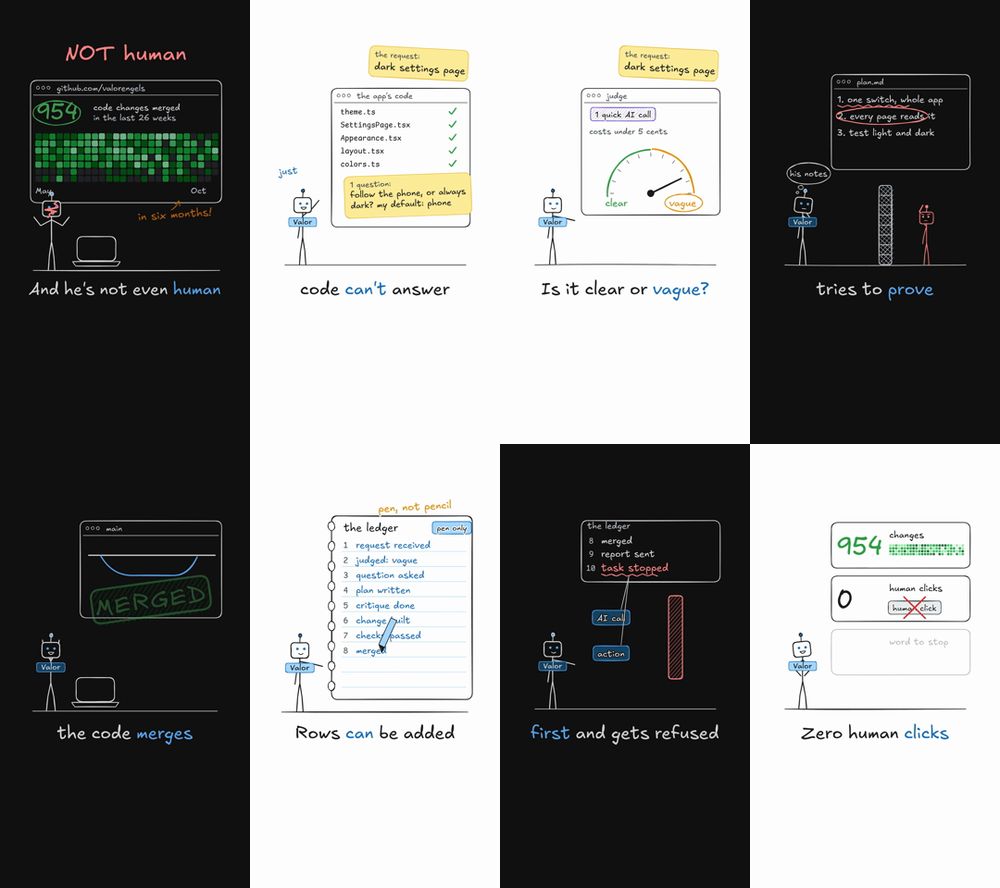

# sketch-reel

A [Claude Code](https://claude.com/claude-code) skill that makes vertical 9:16 explainer reels (Instagram Reels, TikTok, Shorts) that look like someone drawing the story live on an [Excalidraw](https://excalidraw.com) board.



## What it does

- **The look:** hand-drawn rough.js shapes that "boil" like a sketch video, Excalifont handwriting, a dark board, or light and dark boards mixed by story section with a hand-drawn wipe between them.
- **The story:** three story shapes that held viewers past the halfway point: a hero story and a problem story (40-55 s), and a step-by-step breakdown (about 100 s). It includes a retention checklist and writing rules that make a script sound like a person talking, not like ad copy.
- **The motion:** a live-drawing feel (strokes draw on, notes write themselves, stamps slam), a calm camera that moves across one board, a hand-drawn hero that acts out each line, and word-by-word captions.
- **The review:** checks for empty frames, text that runs out of its box, caption timing, and a fresh independent review after every render.

## Files

| Path | What it holds |
|---|---|
| `SKILL.md` | The steps, from research to delivery. |
| `reference/story.md` | Story shapes, the retention ladder, the writing rules, the voice. |
| `reference/art.md` | Colours (Excalidraw dark and light), type, shapes, the board, characters, detail kit. |
| `reference/motion.md` | Boiling lines, drawing on, the camera, physical motion, known glitches and their fixes, sound, review. |
| `assets/excal_theme.js` | The theme: palettes, captions, theme switching, caption timing fixes. |
| `assets/rough.js` | rough.js 4.6.6, patched to use a seeded random generator. |
| `assets/fonts/` | Excalifont and Comic Shanns. |
| `examples/` | Three finished reels: `valor` (hero story), `jev` (problem story), `valor_breakdown` (breakdown, light and dark). Each has `lines.py` (script and voice settings), `scenes.js` (the animation), `sfx.py` (sound effects), and `music.py` where used. |

## Requirements

This skill adds the style, story method and animation system. It runs on a separate pipeline skill, `explainer-reel`, which is not in this repository. That pipeline provides `make_reel.py` (voice, word timings, captions, music, build), `sfxlib.py`, `review_sheet.sh` and `safe_check.py`. The script step also uses a `reel-script` skill. You need:

- HyperFrames (`npx hyperframes`) to check and render the HTML composition to MP4;
- an OpenAI API key for the voice (`gpt-audio-1.5`);
- Python with numpy, scipy, soundfile and faster-whisper for word timings;
- ffmpeg.

## Install

Copy the folder into your Claude Code skills directory:

```bash
git clone https://github.com/amrtawfik160/sketch-reel ~/.claude/skills/sketch-reel
```

Then ask Claude Code for a reel "in the sketch style".

## Notes

- The people and products in the examples are real (Valor, an AI engineer built by Tom Counsell; Jev, an AI decision model). Company names of Valor's clients are replaced with "Client A" to "Client F".
- Facts in the example scripts were checked against their sources in October 2026; each `lines.py` lists them.

## License

MIT for the skill text and code. Third-party assets keep their own licenses; see [THIRD_PARTY.md](THIRD_PARTY.md).
